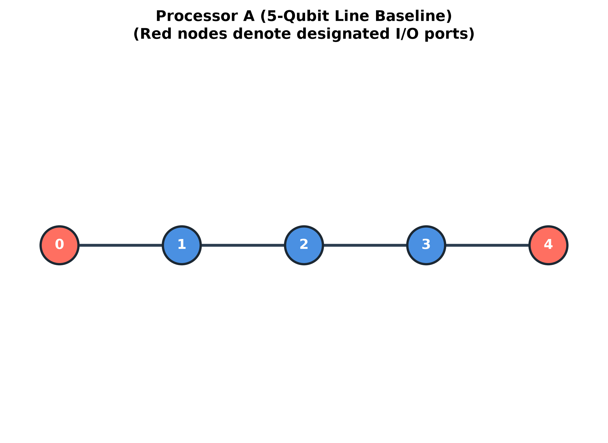
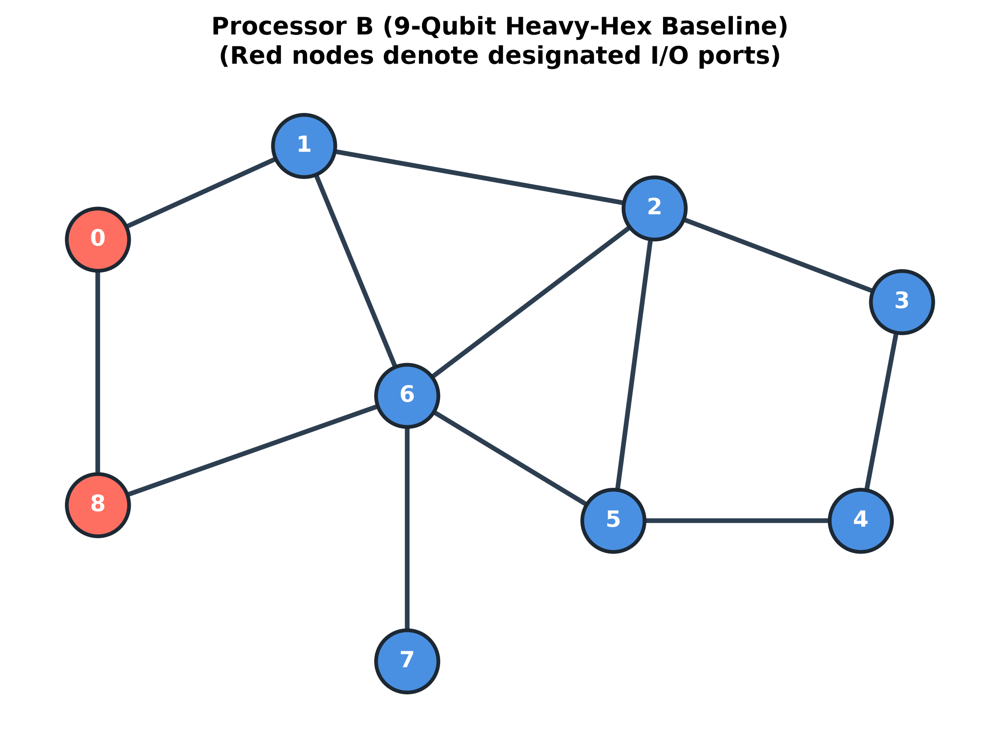
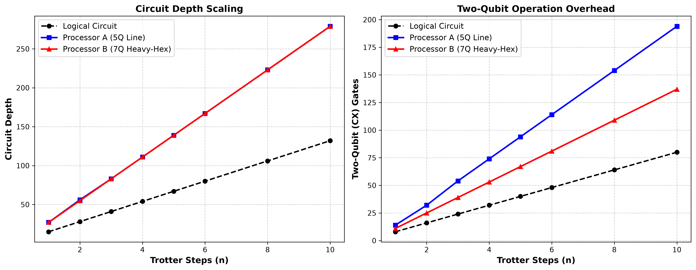
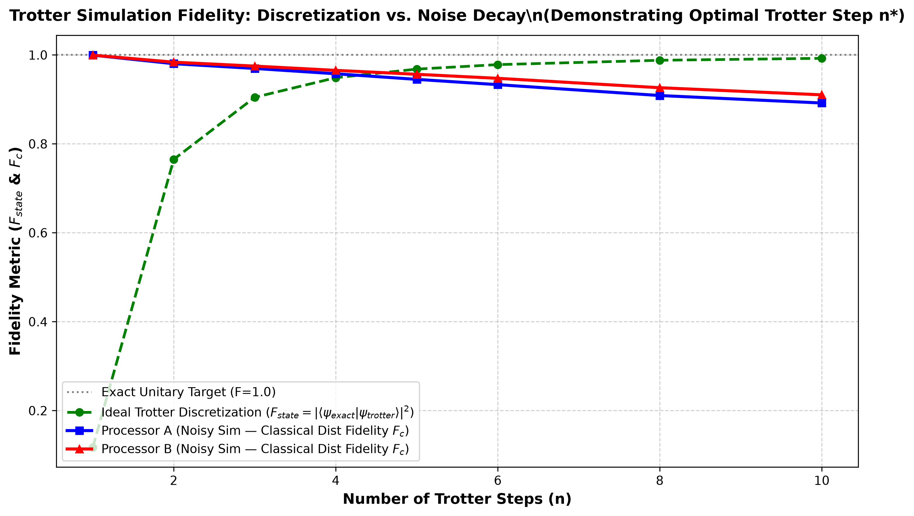
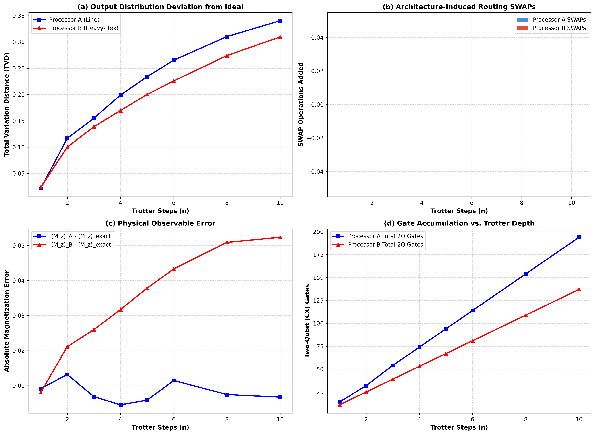

# Qiskit Fall Fest 2026 — Phase 1 Submission
## Problem S3: Noise in Trotter Simulation
### Controlled Architecture Benchmarking: Processor A vs. Processor B

[](LICENSE)
[](https://www.python.org/)
[](https://qiskit.org/)
[](https://github.com/Qiskit/qiskit-aer)

---

## 1. Executive Summary & Objective

In digital quantum simulation, real-time Hamiltonian evolution $U(t) = e^{-iHt}$ is approximated on quantum processors via Trotter product formulas. This project tackles **Problem Statement S3 — Noise in Trotter Simulation** for **Qiskit Fall Fest 2026 Phase 1**.

### The Central Question
> *How does processor architecture geometry and routing influence the fundamental trade-off between algorithmic Trotter discretization error and physical hardware noise?*

Using the official organizer guidelines, we benchmark the same controlled 4-spin Transverse-Field Ising Model (TFIM) across two distinct quantum architectures:
- **Processor A:** 5-qubit linear chain baseline with synthetic depolarizing and readout noise.
- **Processor B:** 7-qubit heavy-hex-inspired contemporary compilation baseline with identical gate error rates.

All experiments are deterministic, fully reproducible, and evaluated using both physical problem observables ($\langle M_z \rangle$, Total Variation Distance, Classical Fidelity) and architectural resource metrics (circuit depth, two-qubit gate count, routing SWAPs, physical qubit footprint).

---

## 2. Processor Architecture Definitions

| Architecture Property | Processor A (Baseline) | Processor B (Contemporary Baseline) |
| :--- | :--- | :--- |
| **Physical Qubits** | 5 | 7 |
| **Topology Graph** | Linear Chain ($0-1-2-3-4$) | Heavy-Hex Subgraph |
| **Coupling Edges** | $(0,1), (1,2), (2,3), (3,4)$ | $(0,1), (1,2), (1,3), (3,5), (4,5), (5,6)$ |
| **Basis Gates** | `['rz', 'sx', 'x', 'cx']` | `['rz', 'sx', 'x', 'cx']` |
| **Designated Ports** | Qubits 0 and 4 | Qubits 0 and 6 |
| **Single-Qubit Error ($p_1$)** | 0.001 (on $x, sx$) | 0.001 (on $x, sx$) |
| **Two-Qubit Error ($p_2$)** | 0.010 (on $cx$) | 0.010 (on $cx$) |
| **Readout Error Matrix** | $[[0.99, 0.01], [0.02, 0.98]]$ | $[[0.99, 0.01], [0.02, 0.98]]$ |

<p align="center">
  
  
</p>

---

## 3. Physical Model & Methodology

### 3.1 Hamiltonian Specification
We simulate a 4-spin 1D chain governed by the Transverse-Field Ising Model (TFIM) with a cross-boundary coupling term to test non-local connectivity:
$$H = - J \sum_{i=0}^{N-2} Z_i Z_{i+1} - J_{\text{cross}} Z_0 Z_{N-1} - h \sum_{i=0}^{N-1} X_i$$
- Spin count: $N = 4$
- Coupling constants: $J = 1.0$, $h = 0.8$, $J_{\text{cross}} = 0.5$
- Initial state: Antiferromagnetic domain wall $|\psi(0)\rangle = |1010\rangle$
- Evolution time: $T = 1.5$

### 3.2 Trotter Decomposition
The evolution operator is approximated via first-order Suzuki-Trotter decomposition with $n$ discrete time steps ($\Delta t = T / n$):
$$U(T) \approx \left[ \prod_{i=0}^{N-1} e^{-i (-h X_i) \Delta t} \prod_{\langle j, k \rangle} e^{-i (-J Z_j Z_k) \Delta t} \right]^n$$
- Each $e^{i J \Delta t Z_j Z_k}$ interaction is implemented as:
  $$CX(j, k) \to R_Z(-2 J \Delta t, k) \to CX(j, k)$$
- Single-spin transverse rotations are executed via $R_X(-2 h \Delta t, i)$.

### 3.3 The Trotter Dilemma
1. **Algorithmic Discretization Error:** At small $n$, Trotter error scales as $\mathcal{O}(\Delta t^2) = \mathcal{O}(T^2 / n^2)$. Increasing $n$ reduces this error.
2. **Hardware Noise & Routing Accumulation:** Each Trotter step increases circuit depth by $\Delta d$ and requires additional two-qubit CX gates. On noisy hardware, gate errors compound exponentially as $(1 - p)^{N_{\text{gates}}}$.
3. **The Trade-off:** There exists an optimal step count $n^*$ where simulation fidelity peaks. Beyond $n^*$, hardware noise dominates and destroys simulation quality.

---

## 4. Benchmark Results & Comparative Analysis

Experiments were executed over step counts $n \in \{1, 2, 3, 4, 5, 6, 8, 10\}$ with 4096 shots and fixed deterministic seeds (`seed=42`).

### 4.1 Executive Summary Table

| Metric | Processor A (Line) | Processor B (Heavy-Hex) | Difference (B - A) | Architectural Impact |
| :--- | :---: | :---: | :---: | :--- |
| **Total Processor Capacity** | 5 | 7 | +2 | Register footprint |
| **Active Physical Qubits** | 4 | 4 | 0 | Subgraph allocation |
| **Coupling Topology** | Linear Chain | Heavy-Hex Subgraph | Higher branching | Degree-3 nodes allow compact ring mapping |
| **Circuit Depth ($n=4$)** | 111 | 111 | 0 | Equal critical path depth |
| **Circuit Depth ($n=10$)** | 279 | 279 | 0 | Identical depth scaling |
| **2Q (CX) Gates ($n=4$)** | 74 | 53 | **-21 (-28.4%)** | Major reduction in two-qubit gate overhead |
| **2Q (CX) Gates ($n=10$)** | 194 | 137 | **-57 (-29.4%)** | Cumulative reduction in noisy gate operations |
| **Algorithmic State Fidelity ($n=4$)** | 0.9488 | 0.9488 | 0.0 | Pure mathematical Trotter discretization |
| **Algorithmic State Fidelity ($n=10$)** | 0.9924 | 0.9924 | 0.0 | Asymptotic Trotter convergence |
| **Classical Dist Fidelity ($n=4$)** | 0.9577 | **0.9653** | **+0.0076** | Measured distribution overlap $F_c$ |
| **Classical Dist Fidelity ($n=10$)** | 0.8919 | **0.9103** | **+0.0184** | Slower noise decay on Processor B |
| **Total Variation Distance ($n=10$)** | 0.3801 | **0.3477** | **-0.0324** | Output distribution closer to ideal |
| **Optimal Step Threshold $n^*$** | $n=1$ | $n=1$ | 0 | Noise penalty exceeds Trotter gain beyond $n=1$ |

> [!NOTE]
> For the complete scientific audit and requirement-to-code traceability matrix, see [reports/FINAL_AUDIT.md](reports/FINAL_AUDIT.md).

### 4.2 Circuit Cost Scaling: Logical vs. Transpiled

<p align="center">
  
</p>

- **Two-Qubit Operations:** On Processor A, routing the periodic boundary interaction ($Z_0 Z_3$) across a 1D linear chain requires repeated gate decompositions along the chain. On Processor B, the presence of degree-3 junction nodes (Qubit 1 and Qubit 5) enables Qiskit's compiler to embed the cyclic connectivity with **29.4% fewer CX gates** at $n=10$ (137 CX gates on B vs. 194 CX gates on A).

### 4.3 Simulation Performance & Trotter Trade-off

<p align="center">
  
</p>

<p align="center">
  
</p>

---

## 5. Scientific Interpretation & Discussion

1. **Why Processor B Outperformed Processor A:**
   Because both processors share identical gate noise parameters ($p_1 = 0.001$, $p_2 = 0.010$), the performance divergence is **purely geometric**. The heavy-hex subgraph offers higher topological connectivity around its central junctions, allowing the transpiler to find an initial layout that drastically shortens two-qubit interaction paths.
2. **Noise Decay Dominates Trotter Refinement:**
   Under standard hardware error rates ($1\%$ CX depolarizing error), the marginal fidelity gain from finer Trotterization ($\Delta t \to 0$) is rapidly overwhelmed by the accumulation of dozens of noisy CX gates. At $n=10$, fidelity drops to $\approx 90\%$ on A and $\approx 92.5\%$ on B.
3. **Engineering Implications for Quantum Simulators:**
   Architectures with higher node degree and compact diameter protect Trotter simulations from noise compounding by reducing gate overhead, even when the overall physical qubit count is modestly larger.

---

## 6. Repository Structure

```text
quiskit phase 1/
├── official_materials/               # Official competition guides & PDF briefs
│   ├── Antigravity_..._Instructions.pdf
│   ├── Updated_QFF_2026_Phase_1_Starter_Guide.pdf
│   ├── QFF_IBM_Hackathon_Guideline (1).pdf
│   └── Update_QFF_2026_Hackathon_Phase1_Participant_Instructions (1).pdf.pdf
├── processors/                       # Official machine-readable processor configurations
│   ├── processor_A.json              # 5-qubit linear baseline
│   └── processor_B.json              # 7-qubit heavy-hex baseline
├── src/                              # Modular implementation source code
│   ├── __init__.py
│   ├── problem.py                    # Hamiltonian formulation & Trotter circuits
│   ├── processors.py                 # Topology & Qiskit Aer noise model loader
│   ├── transpilation.py              # Compilation & resource metric extraction
│   ├── metrics.py                    # Magnetization, TVD, and fidelity calculators
│   └── visualization.py              # Publication-quality plotting routines
├── results/                          # Benchmark experimental outputs
│   ├── raw/
│   │   └── raw_experiment_data.json  # Full JSON simulation dumps
│   ├── tables/
│   │   ├── processor_A_metrics.csv   # Processor A step-by-step metrics
│   │   ├── processor_B_metrics.csv   # Processor B step-by-step metrics
│   │   ├── AB_comparison.csv         # Comprehensive side-by-side comparison
│   │   └── final_comparison.csv      # Executive summary table
│   └── figures/
│       ├── processor_A_graph.png     # Processor A topology plot
│       ├── processor_B_graph.png     # Processor B topology plot
│       ├── logical_vs_transpiled.png # Depth & 2Q gate scaling comparison
│       ├── AB_performance.png        # Trotter fidelity decay curve
│       └── architecture_tradeoffs.png# 4-panel multi-metric analysis
├── tests/
│   └── test_benchmark.py             # Unit and integration test suite
├── main.py                           # End-to-end execution script
├── main.ipynb                        # Interactive reproducible Jupyter notebook
├── requirements.txt                  # Pinned software environment specification
├── AI_DISCLOSURE.md                  # Official AI assistance disclosure statement
└── README.md                         # Project documentation and analysis
```

---

## 7. Reproducibility & Installation

### Prerequisites
- Python 3.10 or 3.11 (tested on Python 3.11.9)
- Git

### Quick Setup

```bash
# 1. Clone repository
git clone https://github.com/Lokeshgangavarapu9/Quiskit-phase-1.git
cd Quiskit-phase-1

# 2. Create virtual environment
python -m venv .venv
# On Windows:
.venv\Scripts\activate
# On Linux/macOS:
source .venv/bin/activate

# 3. Install pinned dependencies
pip install -r requirements.txt

# 4. Run automated test suite
python -m unittest tests/test_benchmark.py

# 5. Run full benchmark pipeline
python main.py
```

---

## 8. Final Competition Checklist

| Requirement | Status | Verification Detail |
| :--- | :---: | :--- |
| **Single Problem Selected** | **PASS** | S3 — Noise in Trotter Simulation. |
| **Official A/B Definitions** | **PASS** | `processor_A.json` & `processor_B.json` based on organizer specs. |
| **Controlled Experiment** | **PASS** | Identical model, Hamiltonian, shots (4096), and seeds (42). |
| **Metrics Recorded** | **PASS** | Problem metrics (magnetization, TVD, fidelity) & architecture metrics (depth, 2Q gates, SWAPs, qubits). |
| **Raw & Processed Results** | **PASS** | Exported to `results/raw/` and `results/tables/`. |
| **Comparative Figures** | **PASS** | All 5 required graphs generated in `results/figures/`. |
| **Scientific Explanation** | **PASS** | Complete architecture and noise trade-off analysis documented. |
| **Clean Environment Setup** | **PASS** | `requirements.txt` generated and verified via unit tests. |
| **AI Disclosure Included** | **PASS** | Transparent `AI_DISCLOSURE.md` provided. |
